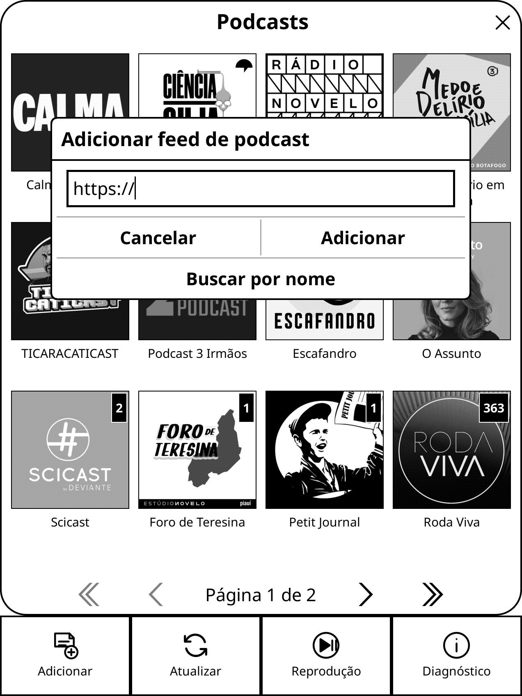

# Podcasts for KOReader

A KOReader plugin for adding RSS/Atom feeds and downloading episodes for offline
playback. KinAMP must be installed and enabled for playback; `free90MiB` is
required for downloads.

## Current features

Version 0.3.12:

- Grid library with up to four podcasts per row, feed artwork, and 14 pt titles.
  Feeds without artwork use a placeholder; covers show the number of unplayed
  episodes when that number is greater than zero.
- Action to mark all episodes in a feed as played.
- RSS/Atom artwork is cached locally in `podcasts/artwork/`. For existing feeds,
  tap **Atualizar (Refresh)** once to fetch covers. JPEG/PNG images up to 4 MiB
  are supported.
- Bottom taskbar shortcuts to add a feed, refresh feeds, open playback controls,
  and view player diagnostics.
- The four shortcuts have their own labeled, SVG-icon taskbar; the feed list and
  pagination remain above it.
- Guidance message when the library is empty.
- Add, refresh, and remove podcast feeds.
- Feeds up to 20 MiB; the plugin keeps at most the first 500 episodes in the
  order supplied by RSS/Atom (usually newest first).
- Integration with `free90MiB`: before downloading, it requests space equal to
  the episode size reported by the RSS feed plus 40 MiB. After a download or
  deletion, it normalizes free space. The feed must provide a valid enclosure
  size for each episode.
- Podcast search by name through Podcast Index. API credentials are entered in
  KOReader and stored locally in `podcasts/podcast_index.lua` without encryption;
  do not share that file.
- Search results show title and author in a single column for smaller screens.
- RSS 2.0 and Atom feeds with audio enclosures.
- Episodes are downloaded to `koreader/podcasts/` via a temporary file. Absolute
  paths are stored because KinAMP runs from `/mnt/us/KinAMP` and cannot resolve
  relative paths.
- Automatic migration of relative paths saved by version 0.2.0.
- Download validation rejects HTML, JSON, XML, and any content that is not MP3,
  M4A/MP4, FLAC, WAV, or OGG Vorbis. Ogg Opus is rejected because KinAMP's decoder
  does not support it. The file extension is chosen from the detected content,
  not the URL, because KinAMP selects its decoder by extension.
- Playback of downloaded files through the KinAMP queue.
- Playback position saving and approximate resume.
- Playback watchdog: if KinAMP opens an episode but reports no duration (usually
  a decoder failure), or its position stops advancing while it reports playing,
  the plugin tries to stop the player and warns the user instead of leaving the
  daemon stuck.
- **Diagnóstico (Diagnostics)** shortcut in the bottom taskbar showing backend
  and player status.

Downloads are streamed to a file rather than held entirely in memory. The
progress dialog shows progress when the feed provides the enclosure size. HTTP
requests are synchronous in this version, so interaction may be limited during
long downloads. Download cancellation is not available yet.

KinAMP has **one queue**. Playing an episode replaces the current music queue
with the list of downloaded podcast episodes, matching KinAMP's own playlist
behavior.

## Usage tutorial

### 1. Open the library

Open **Podcasts** from the KOReader menu. Feeds appear in a grid with up to four
covers per row. A badge on a cover shows how many episodes are not marked as
played; the badge disappears when that count reaches zero. Use the page controls
to browse the library. The fixed bottom bar provides **Adicionar (Add)**,
**Atualizar (Refresh)**, **Reprodução (Playback)**, and
**Diagnóstico (Diagnostics)**.


### 2. Add a podcast

Tap **Adicionar (Add)**. To add a feed manually, enter its RSS/Atom URL and tap
**Adicionar (Add)**. To search by name, tap **Buscar por nome (Search by name)**,
enter a term, and choose a result. The selected RSS URL is returned to the add
dialog; tap **Adicionar (Add)** to confirm.

On the first search, enter your Podcast Index API key and secret. The secret is
masked while typing. Credentials are stored in the KOReader data directory at
`podcasts/podcast_index.lua` without encryption; do not share this file.



After adding a feed, select it in the grid to view its episodes. **Atualizar
(Refresh)** in the bottom bar refreshes registered feeds and fetches covers that
are not cached yet. The plugin accepts feeds up to 20 MiB and keeps up to 500
episodes in the order provided by the feed (usually newest first).

### 3. Browse and download episodes

The episode list shows each title, date, and status: **Not downloaded**,
**Downloaded**, or **Played**. At the end of the list, **Mark all episodes as
played** marks the entire feed at once. The menu also provides actions to refresh
or remove the feed.


Tap an episode that is not downloaded and choose **Download episode**. Before
the transfer, the plugin asks `free90MiB` to release the size reported in the
RSS enclosure plus a 40 MiB safety margin. It requests free-space normalization
after the transfer, even if the transfer fails. The feed must provide a valid
enclosure size; without one, the download does not start, and the plugin still
attempts to normalize free space after the aborted attempt.


The downloaded file is checked for a KinAMP-compatible audio format and linked
to the episode in the library. `free90MiB` manages only its own filler files; it
does not delete books or other Kindle files.

### 4. Play or delete a downloaded episode

For a downloaded episode, the action menu offers **Play episode** and **Delete
downloaded file**, as well as played/unplayed status. Deleting the audio also
requests `free90MiB` to normalize free space.


Tap **Play episode** or **Reprodução (Playback)** in the bottom bar to open
KinAMP controls. You can pause/resume, go to the previous or next episode, or
stop playback. Position is saved for approximate resuming. Because KinAMP has a
single queue, playing a podcast replaces its current music queue with downloaded
episodes from the selected feed.


If something goes wrong, open **Diagnóstico (Diagnostics)** in the bottom bar to
check the backend and player status. See [Playback troubleshooting](#playback-troubleshooting)
below.

## Development installation

Copy `podcast.koplugin/` to `koreader/plugins/` or another KOReader external
plugins directory, then restart KOReader. Install and enable compatible versions
of KinAMP and `free90MiB` as well. This plugin uses KinAMP's internal Lua API
`kinamp_backend.play_from_index`, which is not a stable public API; KinAMP updates
may require changes to `kinamp_client.lua`.

## Updating from GitHub

To link an installed copy to this repository, use the KOReader App Store's
**Installed Plugins → Match with URL**, or Plugin Manager's
**Installed (not in repo) → Link to GitHub repo**. Enter:

```text
mlnunes/koreader-podcast-player
```

Then use **Check for updates** in the plugin manager. Plugin Manager compares the
version in `_meta.lua`; App Store tracks changes to the linked repository.

To publish an update, bump the version in `_meta.lua`, push the commit to `main`,
and create/push a matching tag, for example `v0.3.13`. GitHub Actions packages
the plugin as `podcast.koplugin.zip` and creates a release. The repository's
initial release was `v0.3.10`.

Downloaded audio is stored in:

```text
<KOReader data directory>/podcasts/
```

## Playback troubleshooting

1. Open **Podcasts → Diagnóstico (Diagnostics)** in the bottom bar and note the
   reported status.
2. When updating from an older version, stop a stuck player instance
   (`killall KinAMP-minimal`) before testing. The plugin starts a new player only
   when none is listening on the FIFO; a stuck daemon may still accept commands
   and needs to be stopped.
3. Useful logs:
   - `koreader/crash.log` (on Kindle: `/mnt/us/koreader/crash.log`), including
     `Podcasts: ...` lines;
   - `/mnt/us/KinAMP/kinamp.log`, where KinAMP-minimal records playback attempts
     and decoder errors. `Failed to open file with miniaudio ... (Result: -7)`
     means the file could not be found; this happened in version 0.2.0, which
     stored relative paths.
4. If an episode downloaded before version 0.2.0 will not play, delete it using
   **Delete downloaded file** and download it again; it may be an error page
   saved from the server.

If KinAMP-minimal stops responding, stop it (`killall KinAMP-minimal`); the next
play request starts a new instance.

## Local tests

With LuaJIT installed, run these from the parent directory of the plugin:

```sh
luajit podcast.koplugin/tests/test_feed_parser.lua
luajit podcast.koplugin/tests/test_audio_probe.lua
luajit podcast.koplugin/tests/test_kinamp_client.lua
luajit podcast.koplugin/tests/test_podcast_library.lua
luajit podcast.koplugin/tests/test_podcast_artwork.lua
luajit podcast.koplugin/tests/test_podcast_index_client.lua
luajit podcast.koplugin/tests/test_podcast_storage.lua
```

The tests cover RSS 2.0, Atom, invalid XML, audio-format detection, Podcast Index
authentication and results, playback monitoring (resume, stuck file, cold
queue, and end of episode), absolute-path migration, and the space request
calculation for `free90MiB`. UI, storage operations, and live network behavior
must be tested in KOReader on an emulator or jailbroken Kindle.

## License

GPL-3.0, to remain compatible with KinAMP integration and code. See
<https://www.gnu.org/licenses/gpl-3.0.txt> for the license text.
